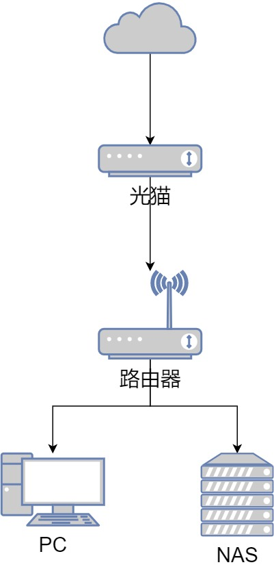
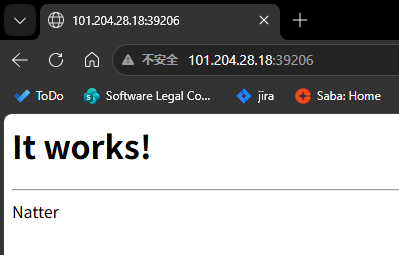

# Natter v2 使用指南

本项目旨在帮助大家应用 [Natter v2](https://github.com/MikeWang000000/Natter)，在 **Full Cone NAT** 网络环境下打开 TCP 端口，获得在 IPv4 可连接的端口，并提供一些 Hook 模板。

<p align="right">
Natter 官方交流群组：<a href="https://jq.qq.com/?_wv=1027&k=EYXohGpC">Q 657590400</a> | <a href="https://t.me/+VS5sjOWGgzsyYjY1">TG</a>
</p>

## Natter 基本使用

### 前提条件

1. 网络环境 NAT 为 **Full Cone NAT**，又称 NAT1。

    以下家庭网络环境很有可能是 NAT1 ，例如：

    * 使用光猫拨号，但拥有光猫控制权，能够设置 DMZ。

    * 光猫为桥接模式，使用路由拨号，拥有路由控制权。

    处于以上环境时，使用 [natter-check](https://github.com/MikeWang000000/Natter/blob/master/natter-check/natter-check.py) 进行 NAT 检测。

    ```bash
    python ./natter-check.py 
    > NatterCheck v2.2.1

    Checking TCP NAT...                  [   OK   ] ... NAT Type: 1
    Checking UDP NAT...                  [   OK   ] ... NAT Type: 1
    ```

    > 注意：如果在使用任何代理软件，关闭 TUN 后再进行 NAT 类型检测。
    > 
    > *如果你的 Linux 宿主机常驻开启了 Mihomo 等代理工具的 TUN 模式且希望两者共存打洞，请参考后文的 [与代理工具（Mihomo / Clash）TUN 模式共存打洞方案](#4-与代理工具mihomo--clash-tun-模式共存打洞方案)。*

2. 运营商没有配置防火墙

    一般我们无法感知，有条件的用户可以使用 `nmap` 在外部网络对出口IP进行 TCP 全端口扫描，期望结果是不为全部关闭。

### 使用教程

PS：由于我的路由限制，暂时只讲解在路由下挂设备上运行 Natter 。

#### 1. 在路由下挂设备上运行

<p align="center">
    
</p>

本例讲解光猫桥接，且在 NAS 上运行 Natter 。

1. 在准备运行 Natter 的设备上下载 Natter

    按照系统架构下载对应的版本：https://github.com/MikeWang000000/Natter/releases

    我这里下载`natter.py`作为演示。

2. 为运行 Natter 的设备配置网络防火墙

    - 开启 DMZ（推荐）
    
        进入路由器后台，找到 DMZ 设置，开启 DMZ 并将运行 Natter 的设备的 IP 地址设置为 DMZ 主机。

        > 注意：开启 DMZ 后，运行 Natter 的设备将会暴露在公网，将会有网络安全风险，请做好防范措施。
        > 
        > 例如：自托管服务监听地址从 `0.0.0.0` 改到内网地址 `192.168.1.100`；开启了内网网段免密，需要关闭（因为流量经过内网设备转发后即是从内网访问，会跳过认证）等。

    - 开启端口转发

        进入路由器后台，找到端口转发设置，添加新的端口转发规则，将外部端口映射到运行 Natter 的设备的内部端口。

        > 由于家宽特性，外部端口会周期改变，手动更新很麻烦，建议使用 DMZ 方式，或者后续使用 Hook 自动设置端口转发。

3. 测试 natter 可用性

    首先直接运行 natter.py，查看是否能够成功打洞。
    ```bash
    python ./natter.py
    2026-06-23 13:44:48 [I] Natter v2.1.1
    2026-06-23 13:44:48 [I] Tips: Use `--help` to see help messages
    2026-06-23 13:44:55 [I] 
    2026-06-23 13:44:55 [I] tcp://192.168.1.100:36741 <--Natter--> tcp://101.204.28.18:39206
    2026-06-23 13:44:55 [I] 
    2026-06-23 13:44:55 [I] Test mode in on.
    2026-06-23 13:44:55 [I] Please check [ http://101.204.28.18:39206 ]
    2026-06-23 13:44:55 [I] 
    2026-06-23 13:44:55 [I] LAN > 192.168.1.100:36741   [ OPEN ]
    2026-06-23 13:44:55 [I] LAN > 192.168.1.100:36741   [ OPEN ]
    2026-06-23 13:44:55 [I] LAN > 101.204.28.18:39206   [ OPEN ]
    2026-06-23 13:44:55 [I] WAN > 101.204.28.18:39206   [ OPEN ]
    2026-06-23 13:44:55 [I]
    ```
        访问`http://101.204.28.18:39206`查看是否能够正常访问测试页面

    <p align="center">
      
    </p>

    如果能够访问，就说明当前网络可以正常使用 Natter 进行打洞。

4. 为内网服务打洞

    接下来我们就要为内网服务打洞了，假设我们要打洞的内网服务是 `192.168.1.100:18888`，那么我们使用参数`-p 18888`来指定内网服务的端口（Natter 将会把数据转发到该端口），使用`-t 192.168.1.100`来指定转发目标的内网 IP 地址。

    如果运行 Natter 的设备有多张网卡或多个 IP，可以使用`-i`指定 Natter 绑定的网卡名或本机 IP 地址；如果不确定，一般可以先省略`-i`。

    ```bash
    python ./natter.py -t 192.168.1.100 -p 18888
    2026-06-23 14:09:07 [I] Natter v2.1.1
    2026-06-23 14:09:13 [I] 
    2026-06-23 14:09:13 [I] tcp://192.168.1.100:18888 <--socket--> tcp://192.168.1.100:40645 <--Natter--> tcp://101.204.28.18:38010
    2026-06-23 14:09:13 [I] 
    2026-06-23 14:09:13 [I] LAN > 192.168.1.100:18888   [ OPEN ]
    2026-06-23 14:09:13 [I] LAN > 192.168.1.100:40645   [ OPEN ]
    2026-06-23 14:09:13 [I] LAN > 101.204.28.18:38010   [ OPEN ]
    2026-06-23 14:09:14 [I] WAN > 101.204.28.18:38010   [ OPEN ]
    2026-06-23 14:09:14 [I]
    ```

    然后访问 log 中打印的 WAN 地址：`101.204.28.18:38010`，如果能够访问到内网服务，就说明打洞成功了。

    建议将目标指向到 Web 服务，方便访问以检测打通是否成功，如：qBittorrent Web 等。

    > 详细参数：[Natter Usage](https://github.com/MikeWang000000/Natter/blob/master/docs/usage.md)

#### 2. 在路由上运行

**待补充** （欢迎大家PR~）

## 高级用法

如果你已经掌握了 Natter 的基本使用方法，想要进一步探索更多高级功能，可以参考以下内容。

### 1. 转发模式

Natter 提供多种途径，将 Natter 端口流量转发至目标端口。

> 总的来说：
> 
> iptables 是最推荐的转发方法。
> 
> 如果您不是 Linux 用户，您可以选择 socat, gost 或者 socket 方法。
> 
> socket 方法，是 Natter 采用的默认转发方法。

| &nbsp;       | iptables | nftables | socat   | gost    | socket  |
| ------------ | -------- | -------- | ------- | ------- | ------- |
| 操作系统限制 | 仅 Linux | 仅 Linux | 跨平台  | 跨平台  | 跨平台  |
| 保留源 IP    | 可       | 可       | 不可    | 不可    | 不可    |
| 转发效率     | 高       | 高       | 中      | 中      | 中      |
| 转发类型     | 内核     | 内核     | 多进程  | 协程    | 多线程  |
| root 权限    | 需要     | 需要     | 无需    | 无需    | 无需    |
| 第三方依赖   | 是       | 是       | 是      | 是      | 否      |
| 依赖最低版本 | 1.4.1    | 0.9.0    | 1.7.2   | 2.3     | -       |
| 依赖最佳版本 | ≥ 1.4.20 | ≥ 1.0.6  | ≥ 1.7.2 | ≥ 2.3   | -       |

如果运行 Natter 的设备是 Linux 系统，建议使用 iptables 转发，需要使用`sudo`权限运行 Natter。

> 详细差异：[Forwarding Modes](https://github.com/MikeWang000000/Natter/blob/master/docs/forward.md)

### 2. 后台保活 & 自动开机运行

- 使用 screen 或 tmux 等工具在后台运行 Natter，避免关闭终端导致 Natter 退出。

- 把以下命令加入开机脚本：`echo "sudo-password" | sudo -S nohup /home/zooter/scripts/nas/nat/natter.py -m iptables -p 18888 -i 192.168.1.100 -e /home/zooter/scripts/nas/nat/vscode-hook.py &`

- 使用 Docker 运行（推荐）

    ```bash
    docker run -d \
        --net=host \
        --cap-add=NET_ADMIN \
        --cap-add=NET_RAW \
        --restart=always \
        --name natter \
        nattertool/natter -m iptables -p 18888 -i 192.168.1.100
    ```
    或者使用 Docker Compose

    ```yaml
    version: '3.8'

    services:
      natter:
        image: nattertool/natter
        container_name: natter
        restart: always
        network_mode: host
        cap_add:
          - NET_ADMIN
          - NET_RAW
        command: -m iptables -p 18888 -i 192.168.1.100
    ```

    查看打洞信息
    ```bash
    docker logs natter
    2026-06-23 07:31:50 [I] Natter v2.2.1
    2026-06-23 07:31:57 [I] 
    2026-06-23 07:31:57 [I] tcp://192.168.1.100:18888 <--iptables--> tcp://192.168.1.100:41177 <--Natter--> tcp://101.204.28.18:40232
    2026-06-23 07:31:57 [I] 
    2026-06-23 07:31:57 [I] LAN > 192.168.1.100:18888   [ OPEN ]
    2026-06-23 07:31:57 [I] LAN > 192.168.1.100:41177   [ OPEN ]
    2026-06-23 07:31:57 [I] LAN > 101.204.28.18:40232   [ OPEN ]
    2026-06-23 07:32:13 [I] WAN > 101.204.28.18:40232   [ OPEN ]
    2026-06-23 07:32:13 [I]
    ```

### 3. Hook 调用

Natter 支持Hook调用，即在打洞成功后执行脚本。

利用这一点，我们可以在打洞成功后自动登录到路由器并设置端口转发，实现一些自动化功能，例如：自动设置端口转发、自动修改 qBittorrent 传输端口、配置消息推送等。

以下提供一些使用模板，仅建议愿意折腾的小伙伴使用，欢迎大家 PR！

* [自动设置端口转发](https://github.com/1368129224/Natter-User-Guide/blob/main/template/auto_forward/auto_forward.md)

    适用于具有 [UCI](https://openwrt.org/zh/docs/guide-user/base-system/uci) 系统的 OpenWRT 路由器，自动设置端口转发。

* [自动设置 qBittorrent 传输端口](https://github.com/1368129224/Natter-User-Guide/blob/main/template/qBittorrent/qBittorrent.md)

    自动修改 qBittorrent 传输端口，提高连通性。

### 4. 与代理工具（Mihomo / Clash）TUN 模式共存打洞方案

许多用户的 Linux / NAS 宿主机上会常驻运行 [Mihomo](https://github.com/MetaCubeX/mihomo)（Clash.Meta）并开启 **TUN 模式**（透明代理）配合 **fake-ip**。

在这种环境下直接运行 Natter，通常会导致打洞完全失效或异常，核心原因包括：
1. **STUN 流量被劫持**：Natter 的 STUN 探测包被捕获进 TUN 虚拟网卡，导致打洞得到的“公网 IP”其实是代理服务器节点的出口，甚至直接超时断连。
2. **DNS 与源地址改写时序陷阱**：在内核打 mark 之前，未显式 bind 源地址的 DNS 查询等 socket 提前命中 TUN 路由，源 IP 被篡改（如 `198.18.0.1`），回包永远无法返回。
3. **Fake-IP 黑洞**：WAN 检测服务（如 `ifconfig.co`）返回 `198.18.x.x` 的保留地址，直连路径无法访问。

通过 **「cgroup v2 隔离 + nftables 策略路由打标 + 本地 DNS 指向 + fake-ip 白名单」** 的组合方案，可以完美实现：**Mihomo TUN 透明代理保持常驻，Natter 打洞与保活流量强制走物理网卡直连，而后置 Hook 仍可按需复用本地代理。**

#### 步骤 1：宿主机配置 nftables 策略路由与自启

在宿主机上，我们利用 cgroup v2 将 Natter 归类到 `natter.slice`，并通过 nftables 在路由决策前将流量打上 `0x80000` 标记（Mihomo 默认会绕过该 mark，直接走 `main` 路由表物理网卡出口）：

1. 新建绕行脚本 `/usr/local/bin/natter-nft-bypass.sh`：
    ```bash
    sudo tee /usr/local/bin/natter-nft-bypass.sh << 'EOF'
    #!/bin/bash
    set -eu
    TABLE="inet natter-bypass"
    if sudo nft list table $TABLE >/dev/null 2>&1; then
      sudo nft flush table $TABLE
    else
      sudo nft add table $TABLE
    fi

    sudo nft -f - << 'NFTEOF'
    table inet natter-bypass {
      chain out {
        # 优先级高于重定向链，确保先打标跳过 TUN
        type route hook output priority mangle - 5; policy accept;
        # 匹配 natter.slice 下所有进程的 socket，打上 0x80000 标记直出物理网卡
        socket cgroupv2 level 1 "natter.slice" mark set 0x80000 counter comment "natter direct egress"
      }
    }
    NFTEOF
    EOF

    sudo chmod +x /usr/local/bin/natter-nft-bypass.sh
    ```

2. 创建 systemd 服务 `/etc/systemd/system/natter-direct-route.service`，确保早于 Docker 开机运行：
    ```ini
    [Unit]
    Description=Natter cgroup mark for direct egress (mihomo TUN bypass)
    Wants=network-online.target
    After=network-online.target
    Before=docker.service

    [Service]
    Type=oneshot
    RemainAfterExit=yes
    ExecStart=/usr/local/bin/natter-nft-bypass.sh

    [Install]
    WantedBy=multi-user.target
    ```

3. 启用并启动服务：
    ```bash
    sudo systemctl daemon-reload
    sudo systemctl enable --now natter-direct-route.service
    ```

#### 步骤 2：配置 Mihomo 的 fake-ip-filter

编辑 Mihomo 的 `config.yaml`，在 `dns.fake-ip-filter` 列表中加入 Natter 打洞检测和所用的 STUN 域名，确保其返回真实物理 IP 而非 fake-ip：

```yaml
dns:
  enable: true
  enhanced-mode: fake-ip
  fake-ip-filter:
    - "ifconfig.co"
    - "portcheck.transmissionbt.com"
    - "stun.nextcloud.com"
    - "stun.freeswitch.org"
    - "turn.cloudflare.com"
```
修改完成后执行 `systemctl restart mihomo` 使其生效。

#### 步骤 3：构建 Natter Docker 运行环境

为了避开 Docker 自动重置 DNS 导致的源地址时序陷阱，我们让 host 网络容器的 DNS 指向宿主机共享回环口的 `127.0.0.53`（systemd-resolved）。

1. 准备 `resolv.conf`：
    ```text
    nameserver 127.0.0.53
    options edns0 trust-ad
    search .
    ```

2. 准备入口脚本 `natter-entrypoint.sh`：
    ```bash
    #!/bin/sh
    set -eu
    # 覆盖容器内 resolv.conf，确保走 host loopback DNS，防止被 TUN 篡改源 IP
    if [ -f /opt/natter-resolv.conf ]; then
      cp /opt/natter-resolv.conf /etc/resolv.conf || true
    fi
    exec /opt/natter.py "$@"
    ```
    赋予执行权限：`chmod +x natter-entrypoint.sh`

3. 准备 `Dockerfile`（以支持常用 requests 模块及自定义 entrypoint 为例）：
    ```dockerfile
    FROM nattertool/natter:debian

    RUN apt-get update \
        && apt-get install -y --no-install-recommends python3-requests \
        && rm -rf /var/lib/apt/lists/*

    COPY natter-entrypoint.sh /usr/local/bin/natter-entrypoint.sh
    RUN chmod 755 /usr/local/bin/natter-entrypoint.sh
    ENTRYPOINT ["/usr/local/bin/natter-entrypoint.sh"]
    ```

#### 步骤 4：配置 Docker Compose

在 `docker-compose.yml` 中指定 `cgroup_parent: natter.slice`，并选用国内直连可达的优质 STUN 池：

```yaml
version: '3.8'

x-natter-common: &natter-common
  build:
    context: .
    dockerfile: Dockerfile
  network_mode: host
  cgroup_parent: natter.slice
  cap_add:
    - NET_ADMIN
    - NET_RAW
  restart: always
  environment:
    TZ: Asia/Shanghai
  volumes:
    - ./hooks:/opt/hooks
    - ./resolv.conf:/opt/natter-resolv.conf:ro

services:
  natter-service:
    <<: *natter-common
    container_name: natter-service
    # -i: 绑定物理网卡 IP
    # -s: 选用国内直连连通性好的 STUN（避免使用已被运营商阻断的 Google STUN）
    # -p: 目标内网服务端口
    command: >
      -m iptables
      -i 192.168.1.100
      -s stun.nextcloud.com
      -s stun.freeswitch.org
      -s turn.cloudflare.com
      -h 110.242.69.21
      -p 22
      -e /opt/hooks/notify-hook.py
```

> **提示：Hook 脚本如何访问境外接口？**
> 
> Natter 本体需要直连物理网卡打洞，但如果你的 Hook 脚本需要调用境外接口（例如更新 Cloudflare DNS、发送 Telegram 通知或更新 GitHub Gist），可以在 Python 脚本中显式配置代理指向宿主机的 Mihomo 端口，例如：
> ```python
> proxies = {
>     "http": "http://127.0.0.1:57890",
>     "https": "http://127.0.0.1:57890",
> }
> requests.post(api_url, json=payload, proxies=proxies, timeout=15)
> ```

#### 步骤 5：验证与排查

1. **检查 nftables 规则匹配**：
    ```bash
    sudo nft list table inet natter-bypass
    # 观察 counter packets 计数是否随打洞和保活持续增长
    ```
2. **测试路由走向**：
    ```bash
    # 模拟打标流量，期望下一跳为物理路由器网关（如 192.168.1.1 dev enp3s0）
    ip route get 1.1.1.1 mark 0x80000
    # 普通流量走 TUN
    ip route get 1.1.1.1
    ```
3. **查看 Natter 打洞日志**：
    ```bash
    docker logs -f natter-service
    # 观察是否成功打印 WAN > [ OPEN ]
    ```

> 完整、开箱即用的配置文件与脚本模版已整理在仓库中：[template/mihomo_bypass/](template/mihomo_bypass/README.md)。

## Thanks

* [Natter](https://github.com/MikeWang000000/Natter)
