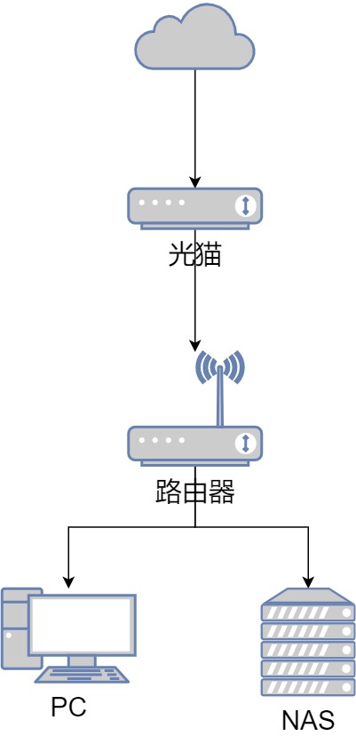
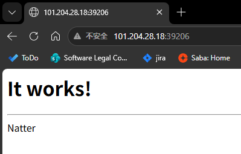
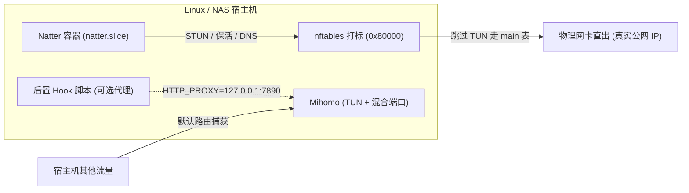

<div align="center">

# Natter v2 实战使用指南与 Hook 模板库

**在无公网 IP 的家宽 NAT1（Full Cone NAT）环境下，利用 Natter 实现高性能 TCP 打洞直连与全流程自动化**

[](https://github.com/MikeWang000000/Natter)
[](#目录)
[](LICENSE)
[](https://github.com/1368129224/Natter-User-Guide/pulls)

Natter 官方交流群组：[QQ 群 657590400](https://jq.qq.com/?_wv=1027&k=EYXohGpC) · [Telegram 群组](https://t.me/+VS5sjOWGgzsyYjY1)

</div>

---

## 项目简介

家庭宽带没有公网 IPv4、第三方中转内网穿透带宽受限？只要你的网络满足 **Full Cone NAT（NAT1 / 全锥型 NAT）**，即可使用 [Natter v2](https://github.com/MikeWang000000/Natter) 直接在运营商 NAT 上打通可从外网直连的 TCP 端口，跑满家宽上行带宽。

本仓库提供**从零入门的图文实操教程**以及**经过实战验证的部署与自动化 Hook 模板**，帮助你解决自建 NAS / Homelab 打洞落地中的常见痛点：

| 模块 / 模板 | 解决什么问题 | 快速入口 |
| :--- | :--- | :--- |
| **基础与路由打洞教程** | NAT1 环境检测、路由下挂 NAS（DMZ / 端口映射）及 OpenWrt 主路由直跑 | [阅读教程](#natter-基本使用) |
| **Mihomo (Clash) TUN 共存方案** | 解决 Linux/NAS 开启透明代理（TUN + Fake-IP）后劫持 STUN 导致打洞失败 | [template/mihomo_bypass](template/mihomo_bypass/README.md) |
| **Cloudflare DDNS 免端口 & 推送** | 自动维护 `A` + `HTTPS(SVCB)` 记录实现**浏览器免输端口号访问**，支持 TG / 企微 / 飞书 / 钉钉 / Bark 通知 | [template/ddns_notify](template/ddns_notify/ddns_notify.md) |
| **qBittorrent 端口自动同步** | 每次打洞端口变动后自动更新 qB 监听端口与转发规则，显著提升 BT / PT 连通率 | [template/qBittorrent](template/qBittorrent/qBittorrent.md) |
| **OpenWrt 自动端口转发** | 无需开启全局 DMZ，通过 SSH + UCI 自动更新路由器防火墙 DNAT 规则 | [template/auto_forward](template/auto_forward/auto_forward.md) |

## 目录

- [Natter 基本使用](#natter-基本使用)
  - [前提条件](#前提条件)
  - [1. 在路由下挂设备上运行](#1-在路由下挂设备上运行)
  - [2. 在路由上运行](#2-在路由上运行)
- [高级用法](#高级用法)
  - [1. 转发模式](#1-转发模式)
  - [2. 后台保活 & 自动开机运行](#2-后台保活--自动开机运行)
  - [3. Hook 调用](#3-hook-调用)
  - [4. 与代理工具（Mihomo / Clash）TUN 模式共存打洞方案](#4-与代理工具mihomo--clash-tun-模式共存打洞方案)

## Natter 基本使用

### 前提条件

1. 网络环境 NAT 为 **Full Cone NAT**，又称 NAT1。

    以下家庭网络环境很有可能是 NAT1，例如：

    * 使用光猫拨号，但拥有光猫控制权，能够设置 DMZ。

    * 光猫为桥接模式，使用路由拨号，拥有路由控制权。

    处于以上环境时，使用 [natter-check](https://github.com/MikeWang000000/Natter/blob/master/natter-check/natter-check.py) 进行 NAT 检测。

    ```bash
    python3 ./natter-check.py
    > NatterCheck v2.2.1

    Checking TCP NAT...                  [   OK   ] ... NAT Type: 1
    Checking UDP NAT...                  [   OK   ] ... NAT Type: 1
    ```

    > 注意：如果在使用任何代理软件，关闭 TUN 后再进行 NAT 类型检测。
    >
    > *如果你的 Linux 宿主机常驻开启了 Mihomo 等代理工具的 TUN 模式且希望两者共存打洞，请参考后文的 [与代理工具（Mihomo / Clash）TUN 模式共存打洞方案](#4-与代理工具mihomo--clash-tun-模式共存打洞方案)。*

2. 运营商没有配置防火墙

    一般我们无法感知，有条件的用户可以使用 `nmap` 在外部网络对出口 IP 进行 TCP 全端口扫描，期望结果是不为全部关闭。

### 使用教程

#### 1. 在路由下挂设备上运行

<p align="center">
    
</p>

本例讲解光猫桥接，且在 NAS 上运行 Natter。

1. 在准备运行 Natter 的设备上下载 Natter

    按照系统架构下载对应的版本：https://github.com/MikeWang000000/Natter/releases

    我这里下载 `natter.py` 作为演示。

2. 为运行 Natter 的设备配置网络防火墙

    - 开启 DMZ（推荐）

        进入路由器后台，找到 DMZ 设置，开启 DMZ 并将运行 Natter 的设备的 IP 地址设置为 DMZ 主机。

        > 注意：开启 DMZ 后，运行 Natter 的设备将会暴露在公网，将会有网络安全风险，请做好防范措施。
        >
        > 例如：自托管服务监听地址从 `0.0.0.0` 改到内网地址 `192.168.1.100`；开启了内网网段免密，需要关闭（因为流量经过内网设备转发后即是从内网访问，会跳过认证）等。

    - 开启端口转发

        进入路由器后台，找到端口转发设置，添加新的端口转发规则，将外部端口映射到运行 Natter 的设备的内部端口。

        > 由于家宽特性，外部端口会周期改变，手动更新很麻烦，建议使用 DMZ 方式，或者后续使用 [自动设置端口转发 Hook](template/auto_forward/auto_forward.md)。

3. 测试 Natter 可用性

    首先直接运行 `natter.py`，查看是否能够成功打洞。
    ```bash
    python3 ./natter.py
    2026-06-23 13:44:48 [I] Natter v2.1.1
    2026-06-23 13:44:48 [I] Tips: Use `--help` to see help messages
    2026-06-23 13:44:55 [I]
    2026-06-23 13:44:55 [I] tcp://192.168.1.100:36741 <--Natter--> tcp://101.204.28.18:39206
    2026-06-23 13:44:55 [I]
    2026-06-23 13:44:55 [I] Test mode in on.
    2026-06-23 13:44:55 [I] Please check [ http://101.204.28.18:39206 ]
    2026-06-23 13:44:55 [I]
    2026-06-23 13:44:55 [I] LAN > 192.168.1.100:36741   [ OPEN ]
    2026-06-23 13:44:55 [I] LAN > 101.204.28.18:39206   [ OPEN ]
    2026-06-23 13:44:55 [I] WAN > 101.204.28.18:39206   [ OPEN ]
    2026-06-23 13:44:55 [I]
    ```

    访问 `http://101.204.28.18:39206` 查看是否能够正常访问测试页面：

    <p align="center">
      
    </p>

    如果能够访问，就说明当前网络可以正常使用 Natter 进行打洞。

4. 为内网服务打洞

    接下来我们就要为内网服务打洞了，假设我们要打洞的内网服务是 `192.168.1.100:18888`，那么我们使用参数 `-p 18888` 来指定内网服务的端口（Natter 将会把数据转发到该端口），使用 `-t 192.168.1.100` 来指定转发目标的内网 IP 地址。

    如果运行 Natter 的设备有多张网卡或多个 IP，可以使用 `-i` 指定 Natter 绑定的网卡名或本机 IP 地址；如果不确定，一般可以先省略 `-i`。

    ```bash
    python3 ./natter.py -t 192.168.1.100 -p 18888
    2026-06-23 14:09:07 [I] Natter v2.1.1
    2026-06-23 14:09:13 [I]
    2026-06-23 14:09:13 [I] tcp://192.168.1.100:18888 <--socket--> tcp://192.168.1.100:40645 <--Natter--> tcp://101.204.28.18:38010
    2026-06-23 14:09:13 [I]
    2026-06-23 14:09:13 [I] LAN > 192.168.1.100:18888   [ OPEN ]
    2026-06-23 14:09:13 [I] LAN > 192.168.1.100:40645   [ OPEN ]
    2026-06-23 14:09:13 [I] LAN > 101.204.28.18:38010   [ OPEN ]
    2026-06-23 14:09:14 [I] WAN > 101.204.28.18:38010   [ OPEN ]
    2026-06-23 14:09:14 [I]
    ```

    然后访问日志中打印的 WAN 地址：`101.204.28.18:38010`，如果能够访问到内网服务，就说明打洞成功了。

    建议将目标指向到 Web 服务，方便访问以检测打通是否成功，如：qBittorrent Web 等。

    > 详细参数：[Natter Usage](https://github.com/MikeWang000000/Natter/blob/master/docs/usage.md)

#### 2. 在路由上运行

如果由 OpenWrt 等软路由/主路由直接负责 PPPoE 拨号，直接在路由上运行 Natter 可以省去配置下挂设备 DMZ 的步骤：

1. **环境准备**：确保路由器已安装 `python3`（OpenWrt 可执行 `opkg update && opkg install python3-light`）并下载 `natter.py`。
2. **固定本地监听端口并放行 WAN 入站**：
    路由器的 WAN 口防火墙默认拒绝外部主动入站连接。我们可以通过 `-b` 参数固定 Natter 在路由 WAN 口绑定的端口（如 `34567`），并在防火墙中添加一条通信规则放行该 TCP 端口：
    ```bash
    # OpenWrt UCI 放行 WAN 入站 TCP 34567 端口（仅需执行一次）
    uci add firewall rule
    uci set firewall.@rule[-1].name='Allow-Natter'
    uci set firewall.@rule[-1].src='wan'
    uci set firewall.@rule[-1].proto='tcp'
    uci set firewall.@rule[-1].dest_port='34567'
    uci set firewall.@rule[-1].target='ACCEPT'
    uci commit firewall
    /etc/init.d/firewall reload
    ```
3. **启动 Natter 转发至本机或内网下挂设备**：
    ```bash
    # -i 指定拨号接口（如 pppoe-wan），-b 固定绑定端口 34567，转发到内网 NAS 的 18888 端口
    python3 ./natter.py -m iptables -i pppoe-wan -b 34567 -t 192.168.1.100 -p 18888
    ```
    > 注：若路由固件使用 `fw4`（nftables），可将 `-m iptables` 替换为 `-m nftables`。欢迎大家提交更多路由固件的实战 PR！

## 高级用法

如果你已经掌握了 Natter 的基本使用方法，想要进一步探索更多高级功能，可以参考以下内容。

### 1. 转发模式

Natter 提供多种途径，将 Natter 端口流量转发至目标端口。

> 总的来说：
>
> iptables 是最推荐的转发方法。
>
> 如果您不是 Linux 用户，您可以选择 socat, gost 或者 socket 方法。
>
> socket 方法，是 Natter 采用的默认转发方法。

| &nbsp;       | iptables | nftables | socat   | gost    | socket  |
| ------------ | -------- | -------- | ------- | ------- | ------- |
| 操作系统限制 | 仅 Linux | 仅 Linux | 跨平台  | 跨平台  | 跨平台  |
| 保留源 IP    | 可       | 可       | 不可    | 不可    | 不可    |
| 转发效率     | 高       | 高       | 中      | 中      | 中      |
| 转发类型     | 内核     | 内核     | 多进程  | 协程    | 多线程  |
| root 权限    | 需要     | 需要     | 无需    | 无需    | 无需    |
| 第三方依赖   | 是       | 是       | 是      | 是      | 否      |
| 依赖最低版本 | 1.4.1    | 0.9.0    | 1.7.2   | 2.3     | -       |
| 依赖最佳版本 | ≥ 1.4.20 | ≥ 1.0.6  | ≥ 1.7.2 | ≥ 2.3   | -       |

如果运行 Natter 的设备是 Linux 系统，建议使用 iptables 转发，需要使用 `sudo` 权限运行 Natter。

> 详细差异：[Forwarding Modes](https://github.com/MikeWang000000/Natter/blob/master/docs/forward.md)

### 2. 后台保活 & 自动开机运行

- 使用 `screen` 或 `tmux` 等工具在后台运行 Natter，避免关闭终端导致 Natter 退出。

- 把以下命令加入开机脚本（请将密码、路径与 IP 替换为实际值）：

    ```bash
    echo "your-sudo-password" | sudo -S nohup /path/to/natter.py -m iptables -p 18888 -i 192.168.1.100 -e /path/to/hook.py &
    ```

- 使用 Docker 运行（推荐）

    ```bash
    docker run -d \
        --net=host \
        --cap-add=NET_ADMIN \
        --cap-add=NET_RAW \
        --restart=always \
        --name natter \
        nattertool/natter -m iptables -p 18888 -i 192.168.1.100
    ```
    或者使用 Docker Compose：

    ```yaml
    services:
      natter:
        image: nattertool/natter
        container_name: natter
        restart: always
        network_mode: host
        cap_add:
          - NET_ADMIN
          - NET_RAW
        command: -m iptables -p 18888 -i 192.168.1.100
    ```

    查看打洞信息：
    ```bash
    docker logs natter
    2026-06-23 07:31:50 [I] Natter v2.2.1
    2026-06-23 07:31:57 [I]
    2026-06-23 07:31:57 [I] tcp://192.168.1.100:18888 <--iptables--> tcp://192.168.1.100:41177 <--Natter--> tcp://101.204.28.18:40232
    2026-06-23 07:31:57 [I]
    2026-06-23 07:31:57 [I] LAN > 192.168.1.100:18888   [ OPEN ]
    2026-06-23 07:31:57 [I] LAN > 192.168.1.100:41177   [ OPEN ]
    2026-06-23 07:31:57 [I] LAN > 101.204.28.18:40232   [ OPEN ]
    2026-06-23 07:32:13 [I] WAN > 101.204.28.18:40232   [ OPEN ]
    2026-06-23 07:32:13 [I]
    ```

### 3. Hook 调用

Natter 支持通过 `-e` 参数调用 Hook 脚本（需赋予脚本 `chmod +x` 可执行权限），在打洞成功或公网映射变化时自动传入 5 个位置参数：

```text
<hook-script> <protocol> <inner_ip> <inner_port> <outer_ip> <outer_port>
```

利用这一点，我们可以在打洞成功后自动完成路由器端口映射、下载器端口同步、动态域名解析与消息通知等。以下提供开箱即用的脚本模板，欢迎大家 PR！

* [自动设置端口转发（OpenWrt）](template/auto_forward/auto_forward.md)

    适用于具有 [UCI](https://openwrt.org/zh/docs/guide-user/base-system/uci) 系统的 OpenWrt 路由器，免开启全局 DMZ 自动维护端口转发。

* [自动设置 qBittorrent 传输端口](template/qBittorrent/qBittorrent.md)

    打洞后自动同步修改 qBittorrent 监听端口并更新转发，提高 BT / PT 连通率。

* [Cloudflare DDNS（免端口访问）与消息推送通知](template/ddns_notify/ddns_notify.md)

    自动更新 Cloudflare `A` 记录与 `HTTPS` 记录（实现现代浏览器免输入端口号访问），并支持 Telegram / 企微 / 飞书 / 钉钉 / Bark 消息推送。

### 4. 与代理工具（Mihomo / Clash）TUN 模式共存打洞方案

许多用户的 Linux / NAS 宿主机上会常驻运行 [Mihomo](https://github.com/MetaCubeX/mihomo)（Clash.Meta）并开启 **TUN 模式**（透明代理）配合 **fake-ip**。

在这种环境下直接运行 Natter，通常会导致打洞完全失效或异常，核心原因包括：
1. **STUN 流量被劫持**：Natter 的 STUN 探测包被捕获进 TUN 虚拟网卡，导致打洞得到的“公网 IP”其实是代理服务器节点的出口，甚至直接超时断连。
2. **DNS 与源地址改写时序陷阱**：在内核打 mark 之前，未显式 bind 源地址的 DNS 查询等 socket 提前命中 TUN 路由，源 IP 被篡改（如 `198.18.0.1`），回包永远无法返回。
3. **Fake-IP 黑洞**：WAN 检测服务（如 `ifconfig.co`）返回 `198.18.x.x` 的保留地址，直连路径无法访问。

通过 **「cgroup v2 隔离 + nftables 策略路由打标 + 本地 DNS 指向 + fake-ip 白名单」** 的组合方案，可以实现：**Mihomo TUN 透明代理保持常驻，Natter 打洞与保活流量强制走物理网卡直连，而后置 Hook 仍可按需复用本地代理。**



#### 快速部署概览

完整配套文件与前置检查说明已整理在 **[template/mihomo_bypass/](template/mihomo_bypass/README.md)** 目录中，只需三步即可部署：

1. **宿主机安装 nftables 绕行服务**（锚定 `natter.slice` 并为其中的 socket 自动打上 `0x80000` 直连标记）：
    ```bash
    cd template/mihomo_bypass
    sudo cp natter-nft-bypass.sh /usr/local/bin/
    sudo chmod +x /usr/local/bin/natter-nft-bypass.sh
    sudo cp natter-direct-route.service /etc/systemd/system/
    sudo systemctl daemon-reload
    sudo systemctl enable --now natter-direct-route.service
    ```

2. **配置 Mihomo `fake-ip-filter`**：
    在 Mihomo 的 `config.yaml` 中将打洞检测域名与所用 STUN 域名加入白名单（如 `ifconfig.co`、`portcheck.transmissionbt.com`、`stun.nextcloud.com`、`stun.freeswitch.org`、`turn.cloudflare.com`），重启 Mihomo。

3. **启动容器并验证**：
    按实际内网 IP 与目标服务端口修改 [docker-compose.yml](template/mihomo_bypass/docker-compose.yml)，构建并启动：
    ```bash
    docker compose up -d --build
    docker compose logs -f
    ```

> 详细配置、Hook 代理用法及故障排查命令请参阅：[template/mihomo_bypass/README.md](template/mihomo_bypass/README.md)。

## Thanks

* [Natter](https://github.com/MikeWang000000/Natter)
